# Spotify Clone · Spring Boot REST API

     

A music streaming app: users upload songs, build playlists, share them and listen in the browser. Spring Boot REST API with stateless JWT authentication and refresh-token rotation, plus a React frontend with a player bar ([`frontend/`](frontend)).

Part of my 52-week QA Automation roadmap — the first **Spring Boot** project. It is also the system under test for the API-testing weeks (REST Assured, auth, contract tests).

## Try it in 3 steps

```bash
# 1. PostgreSQL database "spotify_music", then the secrets (see "Run" below)
cp config/application-secrets.properties.example config/application-secrets.properties

# 2. API with demo data
./mvnw spring-boot:run "-Dspring-boot.run.arguments=--app.demo.enabled=true"

# 3. Frontend (second terminal)
cd frontend && npm install && npm run dev
```

Open **http://localhost:5173** and log in with the demo account:

| E-mail | Password |
|---|---|
| `demo-listener@example.com` | `Demo-Listen-2026` |

It comes with 8 songs (short generated tones with gradient covers — no copyrighted music in the repo) and 3 playlists. You can also sign up with your own account.

> ⚠️ The demo account's password is public. `app.demo.enabled` is `false` by default — never turn it on for a server other people can reach. The demo data is only created when the account does not exist yet.

## Screenshots

| Songs + player | Playlist |
|---|---|
| 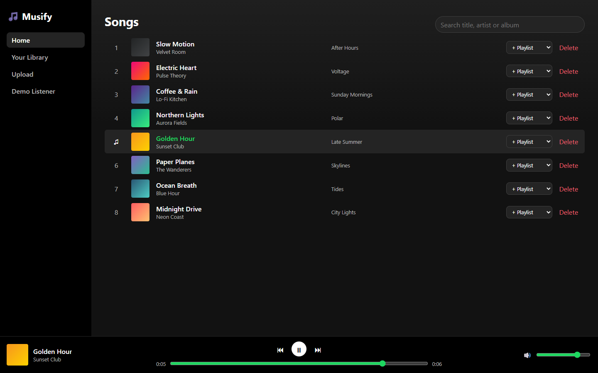 | 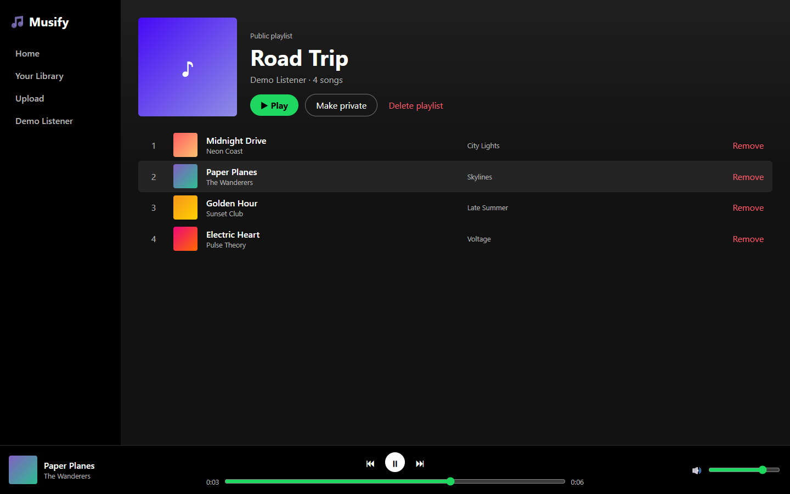 |
| **Search** (title, artist *or* album: "hour" finds *Golden Hour*, *Blue Hour*, *After Hours*) | **Your Library** (own and public playlists) |
| 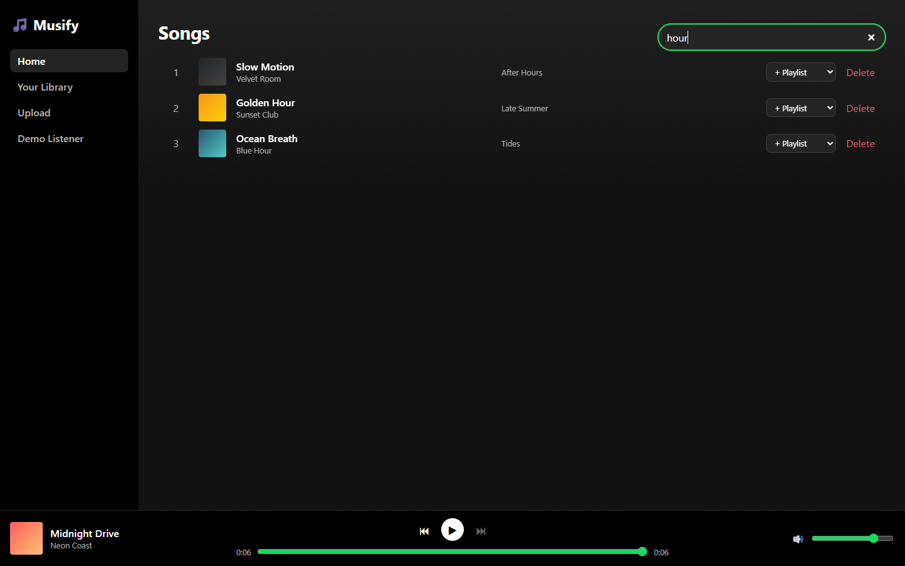 | 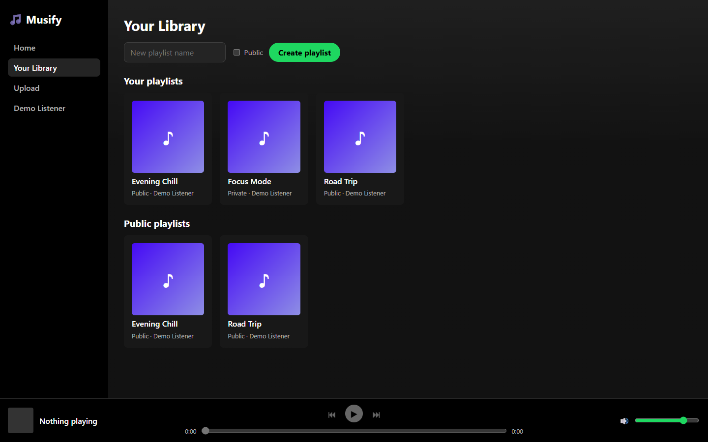 |
| **Upload** | **Profile** |
| 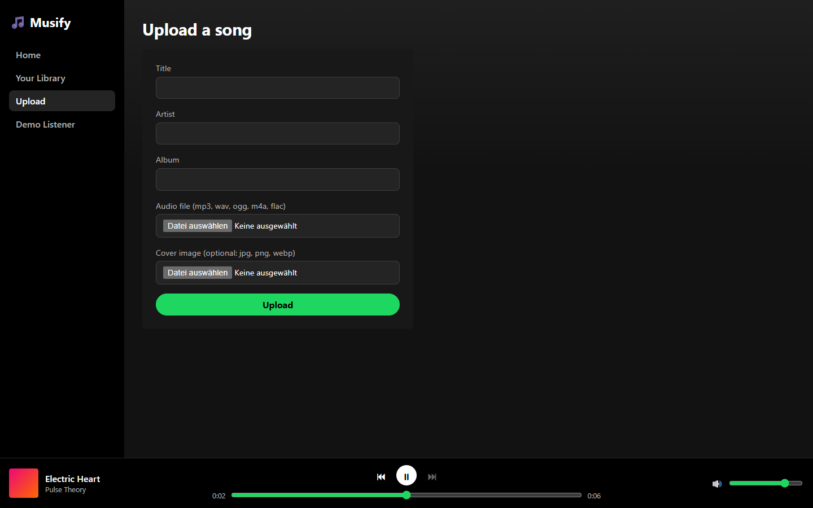 | 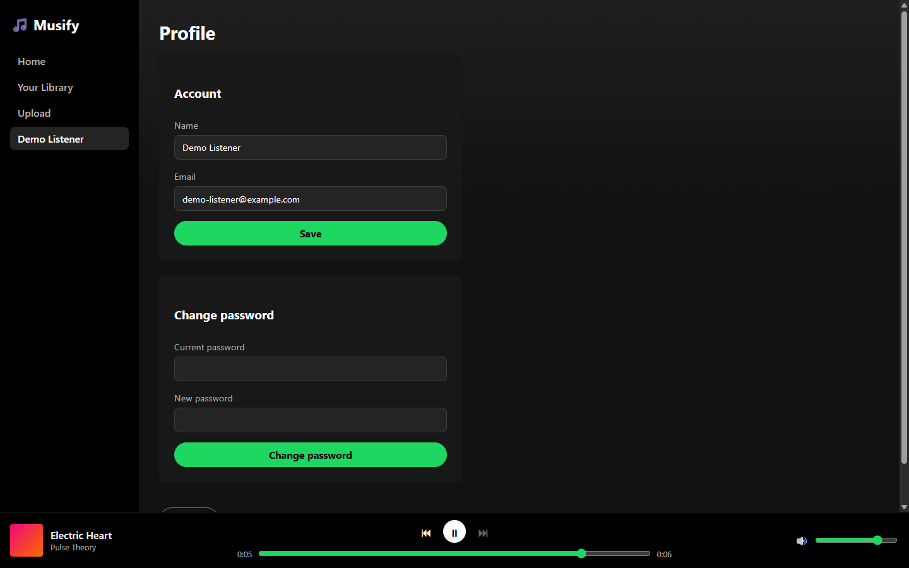 |

<p>
  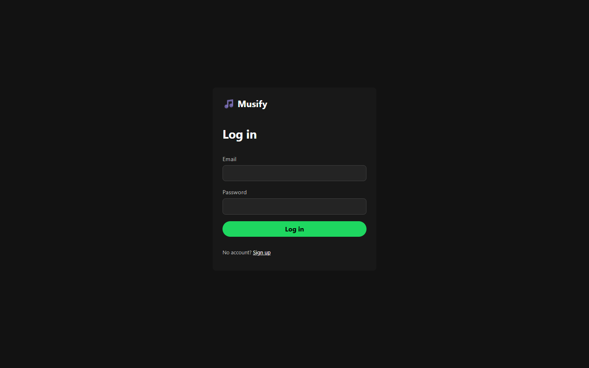
  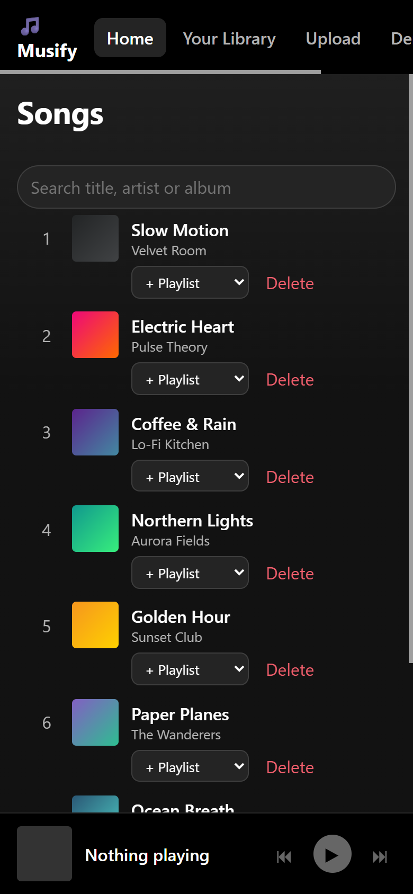
</p>

*Taken from the running app (React + Spring Boot + PostgreSQL); the demo songs are generated sine tones with gradient covers, uploaded through the API.*

## Architecture

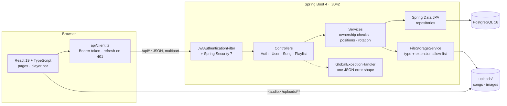

In development Vite proxies `/api` and `/uploads` to the API, so the browser talks to one origin. Tests replace PostgreSQL with in-memory H2.

### Database schema

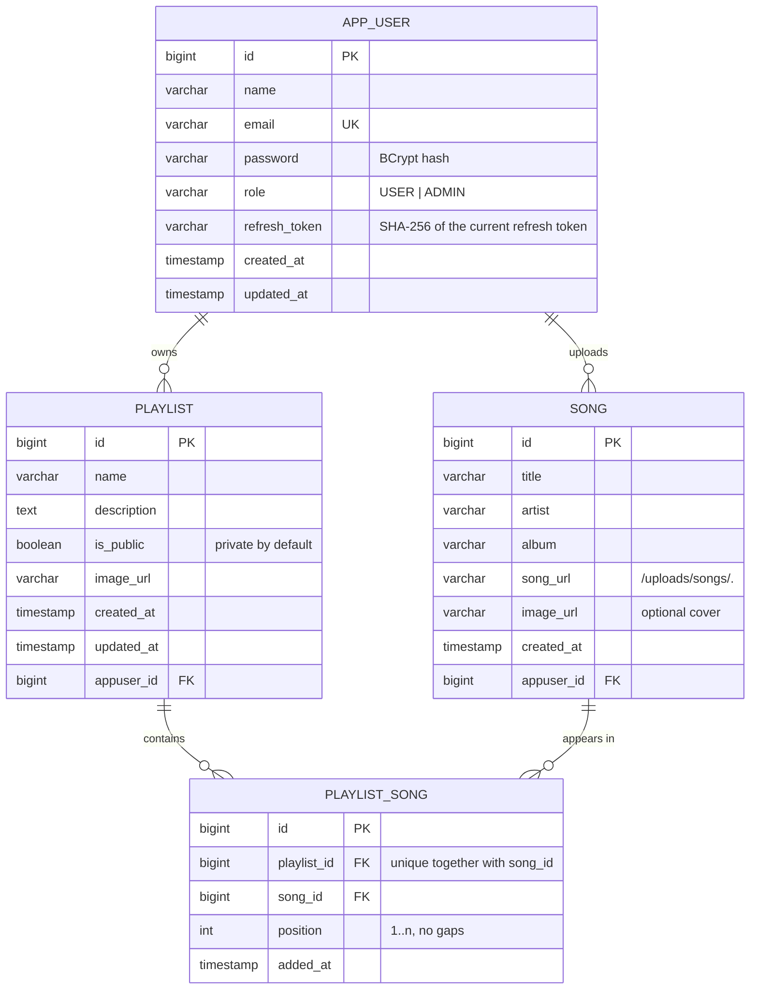

### Login and token refresh

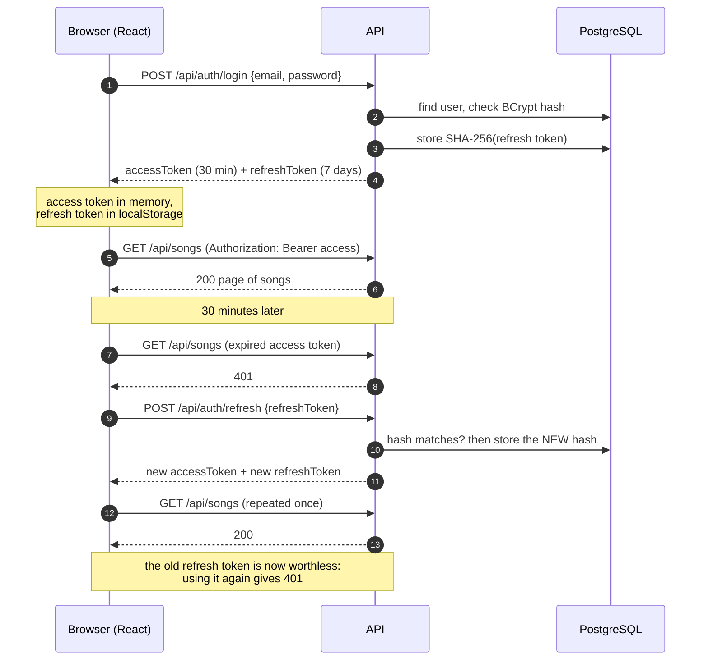

## API

| Method | Path | Auth | Description |
|---|---|---|---|
| POST | `/api/auth/register` | – | create an account (always role `USER`) → tokens |
| POST | `/api/auth/login` | – | e-mail + password → access + refresh token |
| POST | `/api/auth/refresh` | – | refresh token → **new** pair (the old refresh token stops working) |
| POST | `/api/auth/logout` | ✓ | revoke the refresh token |
| GET / PUT | `/api/users/me` | ✓ | own profile |
| PUT | `/api/users/me/password` | ✓ | change password (old one required; revokes the refresh token — see SC-03 below) |
| POST | `/api/songs` | ✓ | `multipart/form-data`: `title`, `artist`, `album`, `file` (audio), `image` (optional) |
| GET | `/api/songs?search=&page=&size=&sort=` | ✓ | paginated list, search in title / artist / album |
| GET | `/api/songs/me`, `/api/songs/{id}` | ✓ | own songs, one song |
| DELETE | `/api/songs/{id}` | owner or admin | also removes it from every playlist |
| POST | `/api/playlists` | ✓ | create (private by default) |
| GET | `/api/playlists/me`, `/api/playlists/public` | ✓ | own / public playlists, paginated |
| GET | `/api/playlists/{id}` | owner, or anyone if public | playlist with songs in order |
| PUT / DELETE | `/api/playlists/{id}` | owner | update / delete |
| POST / DELETE | `/api/playlists/{id}/songs/{songId}` | owner | add (at the end) / remove (positions close up) |
| GET | `/uploads/songs/*`, `/uploads/images/*` | – | the uploaded files (an `<audio>` tag sends no token) |

Every error has the same JSON shape:

```json
{ "timestamp": "…", "status": 400, "error": "Bad Request", "message": "Validation failed",
  "path": "/api/auth/register", "errors": ["email: Email should be valid."] }
```

## Run

1. PostgreSQL with a database `spotify_music`.
2. Secrets: copy `config/application-secrets.properties.example` to `config/application-secrets.properties` and fill it in (that file is gitignored), **or** set the same names as environment variables: `DB_PASSWORD`, `JWT_SECRET` (≥ 32 characters), `MAIL_USERNAME`, `MAIL_PASSWORD`, `GEMINI_API_KEY`.
3. `./mvnw spring-boot:run` → `http://localhost:8042`

```bash
./mvnw test     # 60 tests, in-memory H2 — no PostgreSQL and no secrets needed
```

## Frontend (React)

React 19 + TypeScript + Vite + React Router in [`frontend/`](frontend):

```bash
cd frontend
npm install
npm run dev     # http://localhost:5173 — /api and /uploads are proxied to the API on :8042
npm test        # 14 tests (Vitest + Testing Library)
```

| Page | What you can do |
|---|---|
| Log in / Sign up | the API's validation messages are shown per field |
| Songs | list, search as you type, play, add to a playlist, delete your own |
| Upload | title, artist, album, audio file, optional cover |
| Your Library | create playlists (private / public), browse public playlists |
| Playlist | play all, make public / private, remove songs, delete |
| Profile | change name and e-mail, change password, log out |

A player bar at the bottom plays the queue (previous / next, seek, volume) and stops at the end of the queue.

**Session handling:** the access token lives only in memory, the refresh token in `localStorage` (so a reload keeps you logged in). A `401` triggers one shared refresh call, then the original request is repeated once; if the refresh fails too, you are logged out. Trade-off: `localStorage` is readable by scripts on the page (XSS); an `httpOnly` cookie would be safer but needs CSRF protection.

## Security decisions

| Decision | Why |
|---|---|
| Registration ignores any `role` in the request | the original DTO had a `role` field — anyone could have registered as `ADMIN` |
| Refresh tokens stored only as SHA-256, rotated on every use | a database leak does not hand out sessions; a stolen token works at most once |
| Access and refresh tokens carry a `type` claim | one cannot be used in place of the other |
| Same answer for wrong password and unknown e-mail | does not reveal which e-mails are registered |
| Someone else's private playlist answers **404**, not 403 | does not reveal which playlist ids exist |
| Uploads: content-type + extension allow-list, random file name | no `../../` paths, no `.exe` disguised as `audio/mpeg` |
| Secrets only from environment / a gitignored file | they were in `application.properties` before |
| CORS only for the configured frontend origins (`app.frontend-urls`) | tested: another origin gets 403 |

## Review of the original code — what was wrong

| # | Problem | Fix |
|---|---|---|
| 1 | Mail password, Gemini key, DB password and JWT secret in `application.properties` | moved to env / gitignored file, `*.example` template |
| 2 | `RegisterUserRequest` had `role`, no `password` | `password` added (8–72 chars, BCrypt), `role` removed |
| 3 | `boolean isPublic` + Lombok → JSON field `"public"` | `Boolean isPublic` in the DTOs → `"isPublic"` (regression test) |
| 4 | `@Data` on JPA entities: `equals`/`hashCode`/`toString` touch lazy relations | `@Getter`/`@Setter` |
| 5 | `PlaylistWithSongResponse`: `album` never set, URLs without base URL, `position` as String | fixed, same URLs as `SongResponse`, `Integer` |
| 6 | The same song could be added to a playlist twice | unique constraint + 409 |
| 7 | `application.properties` was not UTF-8 → **`mvn` could not build the project** | re-saved as UTF-8 |
| 8 | Messages: "must **exceed** 100 characters", "between 2 characters" | corrected |
| 9 | `uploads/songs` vs. `upload/images` | one `uploads/` folder |
| 10 | `AppUserRequest` mixed profile, password, role and refresh token | split into `UpdateProfileRequest` and `ChangePasswordRequest` |

## Bugs the tests found in my own code

- **Unknown URL → 500.** The catch-all exception handler also caught Spring's own 404/405/415 errors. Found by the test that checks a deleted song's file is gone. Now Spring's HTTP errors keep their status (regression test `springHttpErrorsKeepTheirStatus`).
- **Tests could not start on this machine:** Surefire's manifest JAR in the temp folder (drive `C:`) and the project on `E:` → JDK 26 dropped `target/classes` from the classpath (`'other' has different root`). Fixed with `useManifestOnlyJar=false`.

## Found by clicking through the real UI

After the unit and API tests were green, I ran backend + frontend against PostgreSQL and used the app like a user (sign up, upload a real WAV file, play it, playlists, profile, log out, phone width). That found four more bugs:

| Bug | Fix |
|---|---|
| Sign-up failed with `Invalid CORS request` when the app was opened as `127.0.0.1` instead of `localhost` (two different origins for the browser) | `app.frontend-urls` is a list: both origins allowed, tested |
| That plain-text error was shown as `Unexpected token 'I' … is not valid JSON` | the client uses the text when the body is not JSON (test) |
| Wrong *old* password answered `401` → the client took it for an expired token, refreshed and sent the password change **twice**; message was "Invalid email or password" | `400 "Old password is wrong"` (test updated); verified in the UI: one request, right message |
| Phone width: song row 428 px wide on a 375 px screen, Delete button off-screen, nav labels wrapped | `minmax(0, 1fr)` columns, actions on a second line, `nowrap` labels — measured again: 375 px |

Also checked in the UI: a reload keeps the session (refresh token), the audio really plays (`paused: false`, position advancing), the player stops at the end, adding the same song twice shows the API's 409 message, and after log out the old refresh token is rejected by the server (401).

## Database migrations (v1.1.0)

The schema is now owned by **Flyway** (`src/main/resources/db/migration`), and Hibernate only validates it (`ddl-auto=validate`).

Why: the independent auth test suite ([Auth-JWT-](https://github.com/Albatros46/Auth-JWT-)) found that **uploading a song without a cover answered 500** on my local database (**SC-06**). The cover had become optional in v1.0.0, but that database was created by the original code, and `ddl-auto=update` never removes a `NOT NULL` constraint. Fresh databases (tests, CI) were fine, so no test inside this repository could see it.

| Migration | Runs on |
|---|---|
| `V1__init.sql` — full schema | new, empty databases |
| `V2__song_image_optional.sql` — drops `NOT NULL` on `song.image_url` | every database; a no-op where the column is already nullable |

A database created before Flyway is **baselined at version 1** (`spring.flyway.baseline-on-migrate=true`) and only gets V2. Verified on the real PostgreSQL 18 database: baselined at 1, V2 applied in 9 ms, all data kept. `LegacyDatabaseMigrationTest` rebuilds the old schema in H2, shows the insert failing, migrates, and shows it working.

## Security findings from the auth test suite

[Auth-JWT-](https://github.com/Albatros46/Auth-JWT-) attacks this API from the outside (52 tests). It confirmed tampered, unsigned (`alg: none`), expired and foreign-signed tokens are all rejected, and that a `role: ADMIN` claim is not trusted. It also found:

| ID | Severity | Finding | Status |
|---|---|---|---|
| SC-06 | High | Upload without cover → 500 on databases created by the original code | **fixed in v1.1.0** (Flyway) |
| SC-02 | Medium | The access token keeps working after logout (until it expires, max. 30 min) | open — needs a token denylist or a per-user token version |
| SC-03 | Medium | After a password change the old access token keeps working (max. 30 min) | open — same fix as SC-02 |
| SC-04 | Medium | No brute-force protection on login (no lockout, no 429) | open |
| SC-01 | Low | 401 answers lack `WWW-Authenticate: Bearer` (RFC 6750) | open |
| SC-05 | Info | The signing algorithm follows the secret's length (HS512 with a 64+ byte secret); the docs said HS256 | docs corrected |

## Tests (60 backend + 14 frontend)

| Class | Tests | What |
|---|---|---|
| `AuthApiTest` | 18 | register, role cannot be chosen, BCrypt + SHA-256 storage, duplicates, validation messages, login, 401 JSON, refresh rotation, token types, logout, change password, CORS, status codes, no stack traces |
| `SongApiTest` | 10 | multipart upload, file served and deleted, wrong type, missing file / title, search, pagination, 404, owner / admin delete |
| `PlaylistApiTest` | 10 | `isPublic` JSON name, private by default, validation, 404 for others' private playlists, read-only for others, positions and gap closing, duplicates, song deletion, update / delete |
| `JwtServiceTest` | 8 | token types, tampering, other secret, expiry, short secret |
| `FileStorageServiceTest` | 6 | random names, path traversal, content type, extension allow-list, delete stays inside the folder |
| `LegacyDatabaseMigrationTest` | 2 | old schema → bug reproduced → migration → fixed; new database gets V1 + V2 |
| `DemoDataSeederTest` | 3 | the README demo login works, 8 songs + 3 playlists, files are real WAV / PNG, no duplicates on restart |
| `TokenHasherTest` · context | 3 | |
| frontend `client.test.ts` | 8 | Bearer header, `ApiError` with field errors, plain-text errors, refresh + retry, **one** refresh for parallel 401s, logout when refresh fails, no refresh for public calls, 204 |
| frontend `AuthPage.test.tsx` | 3 | API error message, field errors, login stores only the refresh token |
| frontend `PlayerContext.test.tsx` | 3 | queue forward / back, stop at the end, empty queue |

Beyond the tests, the app was run against the real PostgreSQL 18 database and the main flow checked with `curl` (register → upload → playlist → refresh rotation → delete).

## Next steps
- Forgot / reset password by e-mail (`ForgotPasswordRequest` is prepared)
- Gemini AI song insights (`SongAiInsightsResponse` is prepared; feature off without `GEMINI_API_KEY`)
- Fix SC-02 / SC-03 (token version per user), SC-04 (login rate limit), SC-01
- Playlist cover upload
- Automate the manual UI check above as Playwright end-to-end tests

## What I learned
- _TODO: 2–3 sentences in your own words_
